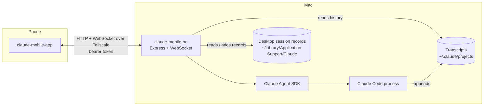

# claude-mobile-be

The Mac-side server for **Claude Mobile**: use the Claude desktop app's **Code** sessions from your phone, as if you were at your laptop. Browse projects and chats, keep chatting, switch model, effort and permission mode, run slash commands, approve tools and start new chats.

The phone app lives in **[claude-mobile-app](https://github.com/param4/claude-mobile-app)**.

Everything stays between your phone and your Mac. The two talk only over your private [Tailscale](https://tailscale.com) network. There's no relay service and no extra cloud copy of your chats; the model calls themselves go to Anthropic as they always do.

## How it works



- **Browsing:** the server reads the desktop app's per-session records (title, folder, model, effort, mode, pinned, archived) and the Claude Code transcripts to serve projects, filtered session lists and chat history.
- **Chatting:** when you send a message, the server resumes that session through the Claude Agent SDK, using the same transcript the desktop app uses, and streams events to the phone over a WebSocket. Tool-permission prompts and Claude's questions pause the turn until you answer on the phone.
- **New chats:** started from the phone, they get a desktop session record too, so the desktop app lists them.
- **Auth:** the SDK uses the Claude login of the Claude Code installation on the Mac. No API key is needed.

## Requirements

- macOS with the **Claude desktop app** (Code tab) signed in, and some Code sessions.
- **Node.js 22+** and **pnpm 10** (`corepack enable` or `npm i -g pnpm`).
- **Tailscale** on the Mac and the phone, signed in to the same account (the free plan is fine).

## Getting started

Clone both repos **side by side**; the app uses `../claude-mobile-be/protocol`.

```bash
mkdir claude-mobile && cd claude-mobile
git clone git@github.com:param4/claude-mobile-be.git
git clone git@github.com:param4/claude-mobile-app.git
```

```bash
cd claude-mobile-be
pnpm install
cp .env.example .env   # optional; the defaults work on most Macs
pnpm start             # listens on your Tailscale IP, port 8787
```

In a second terminal, show the pairing QR code and scan it from the app ("Scan QR code"):

```bash
pnpm pair
```

You only pair once per phone. The token is stored in `~/.claude-mobile/token`; delete that file and restart to un-pair every phone. Then follow the app's README to run the app.

## Configuration

All settings are optional environment variables, read from `.env` (see [.env.example](.env.example)).

| Variable | Default | Purpose |
|---|---|---|
| `CM_HOST` | the Mac's Tailscale IP, else `127.0.0.1` | Address to listen on |
| `CM_PORT` | `8787` | Port |
| `CM_CONFIG_DIR` | `~/.claude-mobile` | Where the pairing token lives |
| `CM_DESKTOP_SESSIONS_DIR` | `~/Library/Application Support/Claude/claude-code-sessions` | Desktop session records |
| `CM_TRANSCRIPTS_DIR` | `~/.claude/projects` | Claude Code transcripts |
| `CM_DEV_CORS_ORIGIN` | unset | Enables CORS for one origin, for the browser preview of the app |

## API

Every request needs `Authorization: Bearer <token>`. The WebSocket also accepts `?token=` because browsers can't set headers on it. Types and schemas are in [`protocol/src/index.ts`](protocol/src/index.ts).

**REST**

| Method and path | Returns |
|---|---|
| `GET /api/health` | `{ ok, name }`, used when pairing |
| `GET /api/projects` | Projects built from desktop sessions (folderless chats are grouped as `no-folder`) |
| `GET /api/sessions?project=&status=&groupBy=&sort=&q=` | Session groups. `status`: active, archived or all. `groupBy`: date, project, state or none. `sort`: recency, alpha or created |
| `GET /api/sessions/:id/messages?limit=&offset=` | Chat history, paged from the newest end |
| `GET /api/catalog?project=` | Slash commands, models and default settings for a new chat |
| `POST /api/sessions` | `{ project, text, attachments?, model?, effort?, permissionMode?, fastMode? }` starts a chat and returns `{ sessionId }`. `project` may also be any folder inside your home folder |
| `POST /api/uploads` | The raw file as the body, its name in `X-File-Name`. Returns `{ id, kind, name, mediaType, size }` |
| `GET /api/uploads/:id` | An uploaded file |
| `GET /api/sessions/:id/images/:entry/:index` | An image from a past message |
| `GET /api/files?project=\|session=&q=` | File paths for `@` mentions, best matches first |
| `GET /api/folders?path=` | Subfolders, for starting a chat in a new folder (home folder only) |
| `GET /api/presets` | The desktop's saved session presets for folders on this Mac |
| `POST /api/sessions/:id/fork` | `{ upToMessageId?, before? }` copies the chat (or part of it) into a new desktop chat |
| `GET /api/sessions/:id/search?q=` | Ids of matching messages, newest first |
| `GET /api/sessions/:id/export` | `{ title, markdown }` |

**WebSocket `/api/ws`**

- **App to server:** `subscribe`, `unsubscribe`, `send` (a message with optional upload ids; with `rewindTo` it replaces that message and everything after it, and `rewindFiles` also restores files), `rewind_preview`, `interrupt`, `settings` (model / effort / permissionMode / fastMode), `permission` (allow, allowAlways or deny, plus answers for questions).
- **Server to app:** `snapshot`, `catalog`, `state`, `settings`, `item`, `delta` (streamed text), `tool_result`, `permission`, `permission_resolved`, `turn_end`, `notice`, `rewind_preview`, `error`.

## Project structure

```
src/
  index.ts        server start-up (HTTP + WebSocket)
  config.ts       env settings, Tailscale address, pairing token
  app.ts          REST routes and auth
  ws.ts           WebSocket protocol
  live.ts         LiveSession: drives one chat via the Agent SDK; Catalog: commands and models
  sessions.ts     listing, filtering, grouping and paging
  desktop.ts      reads and adds desktop session records; scratch folders for "No folder" chats
  transcripts.ts  parses Claude Code JSONL transcripts into chat items; search and Markdown export
  uploads.ts      attachments from the phone (~/.claude-mobile/uploads) and the user message built from them
  files.ts        file search for @ mentions; folder browser
  presets.ts      reads the desktop's session presets
  pair.ts         prints the pairing QR code
protocol/         types and zod schemas shared with claude-mobile-app
test/             vitest suites; a fake SDK stands in for Claude Code
```

## Development

```bash
pnpm dev         # restarts on file changes (this ends any chat in progress)
pnpm test        # vitest
pnpm typecheck   # server + protocol
```

- **Changing the protocol:** edit `protocol/src/index.ts`, then run `pnpm typecheck` here and `npx tsc --noEmit` in claude-mobile-app.
- **Safe testing:** create a throwaway chat in the desktop app (e.g. "mobile test") and run experiments there, not in real chats.
- **Browser preview:** to check UI changes in a browser instead of a phone, run the server with `CM_HOST=127.0.0.1 CM_DEV_CORS_ORIGIN=http://localhost:8081 pnpm start` and the app with `npx expo start --web`.

## Security and privacy

- The server only listens on the Tailscale address, so other devices on your Wi-Fi or the internet can't reach it, and every request needs the pairing token.
- Requests are plain HTTP, but Tailscale encrypts all traffic between your devices (WireGuard).
- New chats can only be started in folders inside your home folder (the folder browser can't leave it), or in a fresh "No folder" scratch folder.
- Attachments are stored in `~/.claude-mobile/uploads`, readable only by you. Images go to Claude inline; other files are handed over by path.
- Desktop records are only ever added; existing ones are never edited. Each new file is written to a temporary name and then linked into place, so it can't overwrite an existing record.

## Known limits

- The desktop app shows messages added from the phone only after you **restart it**.
- Use one device at a time per chat. Typing into the same chat on the laptop and the phone at once can conflict.
- The desktop record format and the transcript format are undocumented, so a Claude app update can break parsing.
- Desktop-only features (browser pane, diff and artifacts panes, side sessions, `/config`-style terminal dialogs) aren't available from the phone.
- The SDK uses your personal Claude login. That's fine for your own use; don't run this as a shared service.
- The Mac must be awake and online. A closed lid sleeps unless the Mac is on power in clamshell mode.

## Roadmap

- [x] Browse projects, sessions and history with desktop-style filters
- [x] Live chat, model/effort/mode switching, slash commands, approvals, questions
- [x] New chats from the phone, listed in the desktop sidebar
- [ ] Voice dictation, with the phone's speech recognition as fallback
- [ ] Start automatically at login (launchd)
